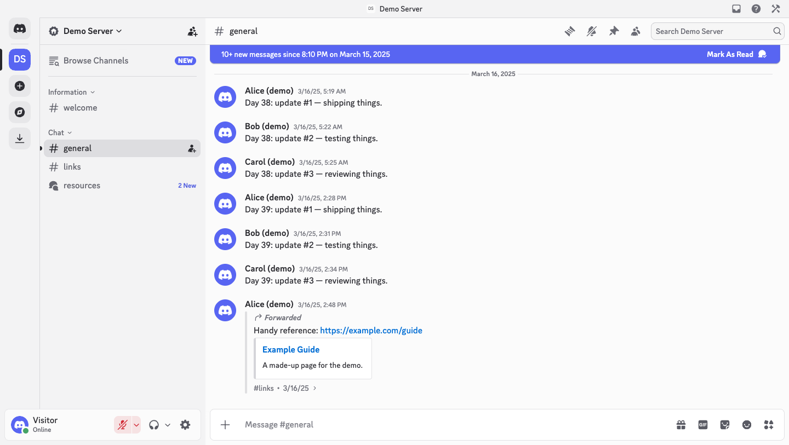

# Discord Archive Client

Read-only archive of a Discord server, served through **Discord's own web client UI** on Cloudflare Pages + D1.
Visitors get the real Discord interface — channels, threads, forum posts, replies, forwards, pins, profile cards,
search — backed by an exported message history instead of Discord's servers.

用 **Discord 官方网页客户端界面**只读地浏览一个服务器的历史聊天记录，部署在 Cloudflare Pages + D1 上。
访客看到的是真正的 Discord 界面（频道、子区、论坛帖子、回复、转发、置顶、用户资料卡、搜索），数据来自导出的消息历史。



Inspired by [aiko-chan-ai/DiscordBotClient](https://github.com/aiko-chan-ai/DiscordBotClient): the same idea of
running the official client against a compatibility API, here as a static-site archive instead of a bot client.

> Discord's client code is **not** included in this repository. `scripts/fetch-client.mjs` downloads the current
> web build from discord.com when you build the site.

---

## Features · 功能

- Official Discord web client UI, light theme by default, password-protected · 官方客户端界面，默认浅色主题，访问口令保护
- Full history paging (before / after / around / jump to message) from compressed message blocks · 完整历史翻页与跳转
- Replies, forwards (message snapshots), mentions, embeds, stickers (PNG/APNG/GIF/Lottie), custom emoji · 回复、转发、提及、嵌入、贴纸、表情
- Attachments with automatic re-signing of expired Discord CDN links (needs `DISCORD_TOKEN`) · 附件签名过期自动续签
- Threads and forum posts (active + archived), pinned messages, user profile cards · 子区、论坛帖子、置顶、资料卡
- Roles, role-colored names (incl. gradients), server nicknames and avatars, member list grouped by role ·
  身份组、用户名颜色（含渐变）、服务器内昵称和头像、按身份组分组的成员列表
- Search: forwarded to Discord's search when a token is configured, otherwise searches the archive · 搜索
- Read-only: sending, reacting, editing return Discord's normal "missing permissions" error · 只读
- Optional cloud sync: a cron Worker pulls new messages and new threads every minute, behind a shared
  rate limiter that backs off on 429/401/403 · 可选的云端增量同步（共享限频，自动避让）
- ~150 Discord API endpoints answered with correctly-shaped data, so client stores don't crash on `{}` · 约 150 个端点按官方形状应答

## How it works · 架构

```
browser ── Discord web client (fetched build, /assets/*, static)
   │  GLOBAL_ENV points every endpoint back at this site
   ├── /api/v9/*   ─┐
   ├── /gateway    ─┼─ Pages Worker (pages/src/index.ts) ── D1: message blocks, side tables, sync cache
   └── /avatars/*, /attachments/*, /stickers/* ─┘                    ▲
                                                                     │ every minute (optional)
                                              sync Worker (sync-worker/) ── Discord API (shared/discord-guard.ts)
```

- **Pages Worker**: password gate, a Discord-compatible REST API and gateway (READY, realtime MESSAGE_CREATE,
  zlib-stream), media proxy with caching, attachment URL re-signing.
- **D1**: messages in zstd-compressed blocks of ~150 (`blocks` + `block_index`), plus side tables for users,
  attachments, threads, pins and forwarded-message content. See [docs/data-format.md](docs/data-format.md).
- **Sync Worker** (optional): one `GET /guilds/:id/channels` per minute, then only channels whose last message moved;
  one thread-discovery request per minute; at most 4 message fetches per run.

## Quick start · 快速开始

Requirements: Node.js 22+, Python 3.10+ with `pip install zstandard`, a Cloudflare account (free plan works).

```bash
git clone <this repo> && cd discord-archive-client
cd pages && npm install && cd ..
cd sync-worker && npm install && cd ..          # only if you want cloud sync

# 1. Discord's web client → pages/public/assets + pages/public/official-shell.html (~12k files, ~360 MB)
node scripts/fetch-client.mjs --out pages/public

# 2. Data: export your server (a bot with View Channels + Read Message History) …
DISCORD_TOKEN='Bot <token>' python3 scripts/export_guild.py --guild <server id> --out export
#    … or try the fictional demo server
python3 scripts/make_demo_export.py --out export

# 3. D1 database
npx wrangler d1 create discord-archive-db          # note the database_id
cp pages/wrangler.example.jsonc pages/wrangler.jsonc   # fill database_id, DISCORD_GUILD_ID, GUILD_NAME

# 4. Import (local for `wrangler pages dev`, remote for production)
python3 scripts/import_export.py --export export --out build/d1 --apply remote --db discord-archive-db

# 5. Deploy
cd pages && npm run build
npx wrangler pages project create discord-archive
npx wrangler pages secret put ACCESS_PASSWORD --project-name discord-archive
npx wrangler pages deploy dist --project-name discord-archive
```

Optional cloud sync:

```bash
cd sync-worker && cp wrangler.example.toml wrangler.toml   # same database_id and DISCORD_GUILD_ID
npx wrangler secret put DISCORD_TOKEN
npx wrangler deploy
```

Faster first load (recommended, after the site runs locally; see below):

```bash
node scripts/boot-bundle.mjs trace --base https://127.0.0.1:8787 --cdp 9222 --password <pw>   # headless Chrome
node scripts/boot-bundle.mjs build --public pages/public && cd pages && npm run build
```

Local development:

```bash
python3 scripts/import_export.py --export export --out build/d1 --apply local --db discord-archive-db
cd pages && npm run build && npm run dev        # https://127.0.0.1:8787 (set ACCESS_PASSWORD in wrangler.jsonc vars or .dev.vars)
```

## Configuration · 配置

Pages project (`pages/wrangler.jsonc` vars, or dashboard; secrets with `wrangler pages secret put`):

| Variable | Required | Meaning |
|---|---|---|
| `DISCORD_GUILD_ID` | yes | Server id of the archive |
| `ACCESS_PASSWORD` (secret) | yes* | Site password. *Or set `PUBLIC_ACCESS = "true"` to make the archive public |
| `GUILD_NAME` | | Server name shown in the UI (default "Discord Archive") |
| `GUILD_ICON` | | Server icon hash (served from Discord's CDN) |
| `GUILD_OWNER_ID` | | Owner user id |
| `HOME_CHANNEL_ID` | | Channel visitors land in (default: first text channel) |
| `VISITOR_NAME` | | Name of the visitor account in the UI (default "Visitor") |
| `LOCALE` / `COUNTRY_CODE` | | Client locale (default `en-US`) / country for billing-related stubs (default `US`) |
| `DISCORD_TOKEN` (secret) | | Enables live sync on visit, Discord search and attachment re-signing |
| `ORIGIN_URL` | | Optional origin for media files that are not in Pages or Discord's CDN |
| `GATEWAY` (Durable Object binding) | | The sync Worker's `DiscordGateway`, for realtime pushes (see Realtime sync) |
| `MEDIA` (R2 binding) | | Permanent media store: the first request for an attachment/avatar downloads it (with a freshly signed Discord link) and keeps it in R2; afterwards every data center serves it from R2 |
| `MEDIA_CACHE` | | `off` = no-cache mode: the server never stores media (no edge cache, no R2); a request streams it from Discord with a currently valid signed link, and only the visitor's browser keeps it (`Cache-Control: private, immutable`). Default: cache on first access |

Sync Worker (`sync-worker/wrangler.toml`): `DISCORD_GUILD_ID`, secret `DISCORD_TOKEN`, optional `GUILD_OWNER_ID`,
`PRIORITY_CHANNEL_IDS` (comma-separated channels synced first when more than 4 changed in one minute),
`REALTIME_GATEWAY` (`"true"` = Discord gateway connection, see below).

`DISCORD_TOKEN` can be a bot token (`Bot <token>`) or a user token. Thread discovery uses `threads/search`, which only
user tokens may call; with a bot token new threads are picked up by re-running the exporter.

## Roles and nicknames · 身份组与服务器昵称

What a member sees while browsing: role-colored names (including gradients), server nicknames and server avatars,
roles on profile cards, and the member list grouped by role. Only what Discord hands out in bulk is synced:

- **Role list**: the sync Worker reads it with one `GET /guilds/:id` every 30 minutes.
- **Each person's roles, nickname and server avatar**: `scripts/backfill_members.mjs` fetches them for every author
  in one gateway session (op 8 member requests of 100 ids, the same requests the official client sends while you
  browse); ~1,300 people take a few seconds. Re-run it to pick up new members and role changes. Members are never
  fetched one by one.

  ```bash
  DISCORD_TOKEN=... node scripts/backfill_members.mjs --guild <server id> --db discord-archive-db [--local]
  ```

  With a user token run it from a normal connection: Discord rejects user-token gateway logins from Cloudflare.
- The Pages gateway answers the client's member requests (op 8) and the member list (op 37) from D1. Visitors keep the
  archive's own `@everyone` permissions. An archive has no presence, so the member list shows everyone offline;
  people without a record (new since the last backfill) show without a role color.

身份组与服务器昵称：只同步能批量获取的。身份组列表由同步 Worker 每 30 分钟一次请求刷新；每个人的身份组、服务器昵称和头像
用 `scripts/backfill_members.mjs` 一次网关会话批量拉取（几秒钟），有新成员时重新运行即可，不逐个请求成员。

## Realtime sync · 实时同步

By default the sync Worker polls Discord's REST API once a minute (new messages appear within ~30–90 s).
With `REALTIME_GATEWAY = "true"` it instead keeps a **Discord gateway connection** open in a Durable Object
(`sync-worker/src/gateway.ts`):

- `MESSAGE_CREATE` / `MESSAGE_UPDATE` / `THREAD_*` for the server are written to D1 as they arrive and pushed to
  visitors through the Pages gateway (bind `GATEWAY` in `pages/wrangler.jsonc`) — about 1 second end to end.
- Disconnects resume the same session (missed events are replayed); new sessions are budgeted (≥ 2 min apart,
  ≤ 40/day); an invalid token (close code 4004) pauses it for 30 minutes. Deleted messages are kept.
- The cron becomes a watchdog: it (re)connects the gateway every minute and runs the REST sync only every 10 minutes
  as a backstop, or every minute again while the gateway is down.
- Free plan: one always-on Durable Object uses ~10,800 of the 13,000 GB-s included per day.
- **Use a bot token.** In testing, Discord closed every user-token IDENTIFY coming from Cloudflare's network with
  `4000 Unknown error` (the same code and payload worked from a residential connection, ~0.2 s delivery). After three
  rejected IDENTIFYs in a row the gateway pauses for 6 hours; the cron keeps polling REST every minute meanwhile.
- A bot needs the Message Content intent; the gateway then only receives what it subscribes to. A user token would
  receive events from every server the account is in, and running it 24/7 is a self-bot: against Discord's Terms of
  Service, with a real risk of the account being restricted.

实时同步：`REALTIME_GATEWAY = "true"` 时由 Durable Object 常驻连接 Discord 网关，新消息约 1 秒推给访客；
定时任务改为看门狗 + 每 10 分钟 REST 补漏。请使用机器人令牌：实测个人令牌从 Cloudflare 机房登录网关会被 Discord 以 4000 拒绝
（连续 3 次后暂停 6 小时，期间照常每分钟 REST 轮询）；个人令牌挂网关也属于 self-bot，违反服务条款。

## Faster first load · 首次加载提速

A cold start of Discord's client makes ~2,400 requests: ~670 scripts and stylesheets listed in its HTML, then ~1,700
chunks its bundler requests once those have run. Each is small, but they queue (two dependent waves), so the first visit
took ~5 s on a fast connection. `scripts/boot-bundle.mjs` packs them into ~10 files:

- `trace` opens the site in a fresh browser context and records which client files a cold start loads
  (`--path` adds more pages, e.g. a forum channel). It writes `pages/boot-trace.json`.
- `build` writes `assets/boot-<hash>.js/.css` and rewrites `official-shell.html` (the original is kept as
  `pages/official-shell.unbundled.html`). Chunks keep their original order around the client's runtime scripts, and
  lazily loaded chunks are stored uncalled and run only when the client asks for them, so nothing starts in a different
  order than before. Files missing from the trace still load on demand.
- The password page prefetches these files, so most of the download happens while the visitor types.

Re-run both after `fetch-client.mjs` downloads a new client build. Measured on the free plan: first messages after
submitting the password in ~1.6–2.6 s instead of ~5.2 s.

首次访问原本要发约 2,400 个请求（两波排队），约 5 秒；`boot-bundle.mjs` 把它们打包成约 10 个文件，口令页还会提前预取。
客户端更新（重新运行 fetch-client）后要重新 trace + build。

## Cloudflare free plan · 免费版注意事项

- 100,000 Worker requests per day for the whole account. `pages/public/_routes.json` keeps `/assets/*`
  (the ~12k client files) out of the Worker; don't remove that, or one page load costs ~2,000 requests.
- `assets/version.*.json` are pinned to the downloaded build; never proxy them to discord.com, or idle tabs reload
  themselves in a loop.
- When the quota runs out, Pages serves `pages/public/index.html` (a notice page) until 00:00 UTC.
- The sync Worker costs ~1,440 requests/day plus ~1–2 Discord API calls per minute.

## Limitations · 限制

- Read-only archive of one server. No DMs, voice, or reactions history beyond what the export contains.
- Discord changes its client often. The compatibility API was developed against web builds 589596 and 641004;
  a future build may call endpoints that need new stubs (unknown endpoints answer 404, which the client tolerates).
- **Terms of Service**: serving Discord's client from another origin, and automating a user account ("self-bot"),
  may violate Discord's Terms of Service. Prefer a bot token, archive only servers you are allowed to archive, and
  keep archives private. This project is not affiliated with Discord.

## Tests

```bash
node test/guard-and-sync.test.mjs                 # offline: rate limiter + sync loop against a fake Discord
python3 scripts/make_demo_export.py --out demo-export && \
  python3 scripts/import_export.py --export demo-export --out build/d1 --apply local --db discord-archive-db
# start `npm run dev` in pages/ (wrangler.jsonc vars: demo ids printed above, ACCESS_PASSWORD=demo) and headless Chrome:
node test/e2e-demo.mjs --base https://127.0.0.1:8787 --cdp 9222 --export demo-export --password demo
```

## Credits · 致谢

- [aiko-chan-ai/DiscordBotClient](https://github.com/aiko-chan-ai/DiscordBotClient) — the approach, endpoint
  response shapes, and the experiments snapshots in `pages/src/experiments/` (GPL-3.0).

## License

GPL-3.0, same as DiscordBotClient. See [LICENSE](LICENSE).
